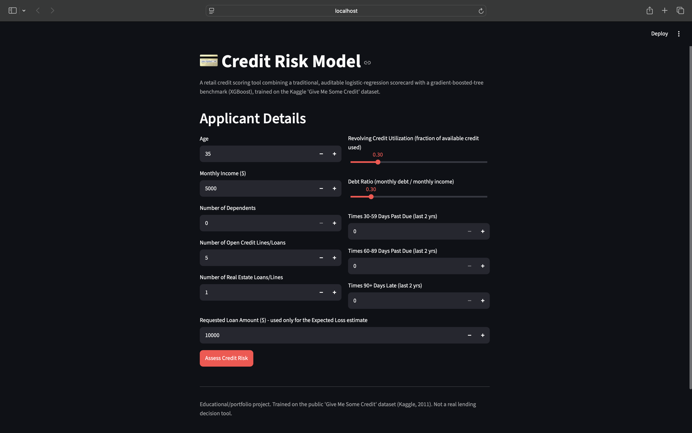
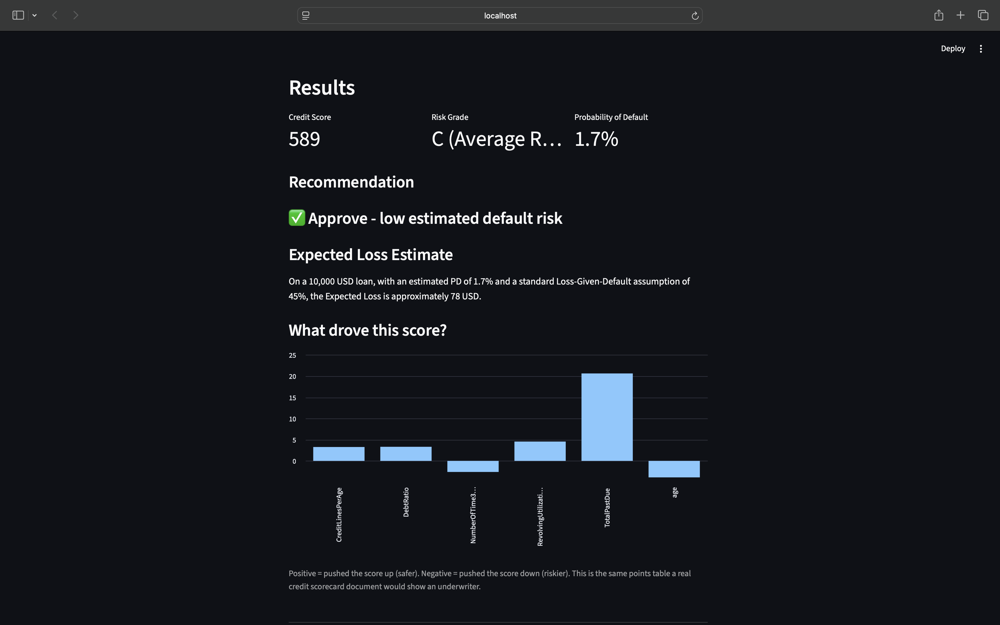
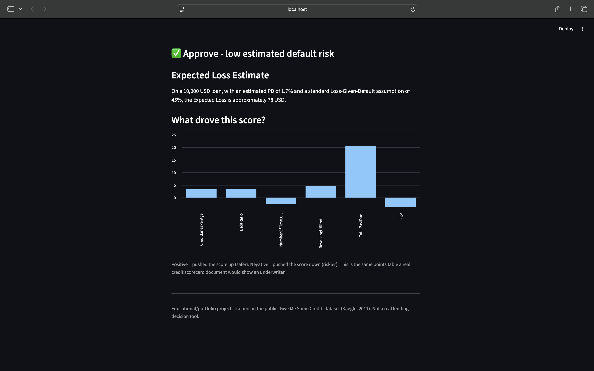

# Credit Risk Model — Consumer Loan Default Prediction

A retail credit scoring project built around the same two approaches real
banks use side by side: an interpretable, regulator-friendly **logistic
regression scorecard** (WOE/IV-based, like a traditional FICO-style score),
and a **gradient-boosted tree model (XGBoost)** as a modern performance
benchmark — with a working **Streamlit app** on top that turns an
applicant's details into a credit score, a risk grade, a Probability of
Default, and a loan recommendation.

> Built as a second portfolio project (after a [Modern Portfolio Theory
optimizer](https://github.com/sarvadnyajadhao/Portfolio-Optimizer)) with the goal of making every modeling decision below
> explainable in an interview, not just "the notebook ran."

## Problem

Given an applicant's financial history, predict the probability they will
experience serious credit delinquency (90+ days past due) within the next 2
years — i.e. estimate their **Probability of Default (PD)**.

## Dataset

[Give Me Some Credit](https://www.kaggle.com/c/GiveMeSomeCredit) (Kaggle,
2011) — 150,000 real consumer credit applicants, 10 features + target.
Default rate: **6.7%** (a genuinely imbalanced classification problem).

## Project structure

```
credit-risk-model/
├── data/                      raw + processed data (not committed if large)
├── src/
│   ├── 01_eda.py              load data, sanity checks
│   ├── 02_clean_data.py       fix data-quality issues (see below)
│   ├── 03_feature_engineering.py
│   ├── 04_woe_iv.py           Weight of Evidence + Information Value
│   ├── woe_utils.py           reusable WOE binning class (fit on train only)
│   ├── 05_scorecard_model.py  logistic regression scorecard + points + PD
│   ├── 06_xgboost_model.py    XGBoost + class-imbalance handling + calibration
│   ├── 07_evaluation.py       AUC, Gini, KS, confusion matrix
│   ├── 08_shap_explain.py     SHAP explainability
│   └── 09_risk_analytics.py   Expected Loss + stress testing
├── models/                    saved, trained model artifacts (.joblib)
├── outputs/                   plots, tables, metrics generated by src/
├── app/streamlit_app.py       the deployed applicant-facing app
└── requirements.txt
```

Run the pipeline in order (`python3 src/01_eda.py`, then `02_...py`, etc.)
from the project root, then launch the app:

```bash
pip install -r requirements.txt
python3 src/01_eda.py
python3 src/02_clean_data.py
python3 src/03_feature_engineering.py
python3 src/04_woe_iv.py
python3 src/05_scorecard_model.py
python3 src/06_xgboost_model.py
python3 src/07_evaluation.py
python3 src/08_shap_explain.py
python3 src/09_risk_analytics.py
streamlit run app/streamlit_app.py
```

## Data cleaning — real issues, found and fixed

| Issue | Finding | Fix |
|---|---|---|
| `age == 0` | 1 row, impossible value | dropped |
| `NumberOfTimes90DaysLate` etc. | 98/96 are sentinel/placeholder codes, not real counts (264/5 rows) | capped at realistic max (17), flagged |
| `RevolvingUtilizationOfUnsecuredLines` | 3,321 rows > 1 (should be a ratio), max 50,708 | winsorized at 99.5th percentile |
| `DebtRatio` | 23% of rows > 1, max 329,664 (driven by missing income) | winsorized at 99.5th percentile |
| `MonthlyIncome` | ~20% missing | median-by-age-group imputation + missingness flag |
| `NumberOfDependents` | ~2.6% missing | median imputation + missingness flag |

## Feature engineering

`TotalPastDue`, `HasBeenLate`, `IncomePerDependent`, `EstimatedMonthlyDebt`,
`CreditLinesPerAge`, `AgeBucket` — see `src/03_feature_engineering.py` for
the reasoning behind each.

## WOE / Information Value — feature selection

Computed on the **training set only** (see `src/woe_utils.py` — bins must
never be learned on test data). Top predictors by IV:

| Feature | IV | Strength |
|---|---|---|
| TotalPastDue | 1.45 | very strong (expected — this is closely related to how the target itself is defined) |
| RevolvingUtilizationOfUnsecuredLines | 1.11 | very strong |
| NumberOfTimes90DaysLate | 0.89 | strong |
| age | 0.25 | medium |
| IncomePerDependent | 0.12 | medium |
| NumberRealEstateLoansOrLines | <0.02 | useless — dropped from the model |

**Binning note:** naive quantile binning silently breaks on zero-inflated
count columns (e.g. 94% of applicants have `NumberOfTimes90DaysLate == 0`),
collapsing them into a single bin and making a genuinely predictive feature
look useless (IV = 0). Fixed by detecting high single-value concentration
and switching to exact-value binning for those columns — see `woe_utils.py`.

## Models

| Model | AUC | Gini | KS |
|---|---|---|---|
| Logistic Regression Scorecard (WOE) | 0.863 | 0.726 | 0.576 |
| XGBoost (gradient-boosted trees) | 0.871 | 0.742 | 0.582 |

XGBoost outperforms the scorecard by **0.008 AUC (0.8 percentage
points)** — meaning the simpler, fully auditable model gives up almost
nothing in raw predictive power. This is the real, quantified answer to
"why use the interpretable model at all."

**Class imbalance:** handled via `scale_pos_weight` (XGBoost) — but this
distorts predicted probabilities (they get pulled toward the up-weighted
class: raw average predicted PD came out at 32% vs a true 6.7% default
rate). **Fixed with Platt scaling** (a calibration logistic regression fit
on the raw scores), restoring predicted PD to 6.7% — matching the true
rate. This calibration-after-weighting step is easy to skip and is a good
interview talking point.

**Confusion matrix (XGBoost, flagging the riskiest 10% of applicants for
review):** catches **55.6%** of all actual future defaulters by reviewing
just 1 in 10 applicants.

## Risk analytics

**Expected Loss** = PD × LGD × EAD. Using the Basel II standard LGD
assumption for unsecured retail credit (45%) and an illustrative average
exposure of $10,000/applicant across the 30,000-applicant test portfolio:

| Scenario | Avg PD | Expected Loss | EL % of exposure |
|---|---|---|---|
| Baseline | 6.7% | $9.04M | 3.01% |
| Mild recession (PD ×1.5) | 10.0% | $13.49M | 4.50% |
| Moderate recession (PD ×2.0) | 12.8% | $17.33M | 5.78% |
| Severe recession (PD ×3.0) | 17.4% | $23.51M | 7.84% |

A severe-recession scenario increases portfolio Expected Loss by **160%**
with zero change in the actual customers — purely from a worse macro
environment. This is the basic logic behind real bank stress-testing
exercises (e.g. CCAR-style).

## The app

`app/streamlit_app.py` takes an applicant's details and returns:
- A points-based **Credit Score**
- A **Risk Grade** (A–E, calibrated to this model's own population — not
  copied from generic FICO cutoffs, which didn't fit this data)
- A calibrated **Probability of Default**
- A plain **loan recommendation** (Approve / Manual Review / Decline)
- An **Expected Loss estimate** for the requested loan amount
- A breakdown of which factors pushed the score up or down

## Application Testing

The Streamlit application was tested with multiple applicant profiles and input scenarios to verify that the application responds correctly to changes in applicant risk and loan amount.

| Test | What was checked | Result |
|---|---|---|
| Low-risk applicant | Normal/healthy financial profile | ✅ Passed |
| Moderate-risk applicant | Increased debt/utilization + delinquency | ✅ Passed |
| High-risk applicant | Severe debt/utilization + multiple delinquencies | ✅ Passed |
| Loan amount test | $10,000 → $20,000 while keeping the applicant unchanged | ✅ Passed |
| Boundary/edge test | Low but valid input values | ✅ Passed |
| Expected Loss display | Correct formatting and calculation | ✅ Passed |

### Key test observations

- The low-risk applicant produced a **1.1% PD** and an **Approve** recommendation.
- The moderate-risk applicant produced a **10.8% PD** and a **Manual Review** recommendation.
- The high-risk applicant produced a **61.6% PD** and a **Decline / Require Collateral** recommendation.
- When the requested loan amount increased from **$10,000 to $20,000**, the Credit Score and PD remained unchanged while Expected Loss approximately doubled from **$2,771 to $5,541**.
- A boundary-style applicant with low but valid input values was processed successfully without application errors.

## Known limitations (be upfront about these in an interview)

- `EAD` (loan exposure) is not in the original dataset — the app lets the
  user supply a requested loan amount; the portfolio-level Expected Loss
  figures above use an assumed average exposure, clearly labeled as such.
- `LGD` is a standard regulatory assumption, not derived from this bank's
  own recovery data (which doesn't exist in this dataset).
- Stress-test multipliers are illustrative, not derived from an actual
  macroeconomic model (no GDP/unemployment data was joined in).
- The dataset is from 2011 US consumer credit; a real deployment would need
  periodic retraining and population stability monitoring.

## Author

Sarvadnya Jadhao — B.Com (Computer Applications),
Dr. Ambedkar Institute (RTMNU).

## Application Screenshots

### 1. Applicant Input Form
Enter applicant financial and credit-history details to assess credit risk.



### 2. Credit Risk Assessment Results
View the model's predicted probability of default, credit score, risk grade, and recommendation.



### 3. Risk Explanation and Expected Loss
Explore the estimated financial loss and feature contributions behind the applicant's risk assessment.


